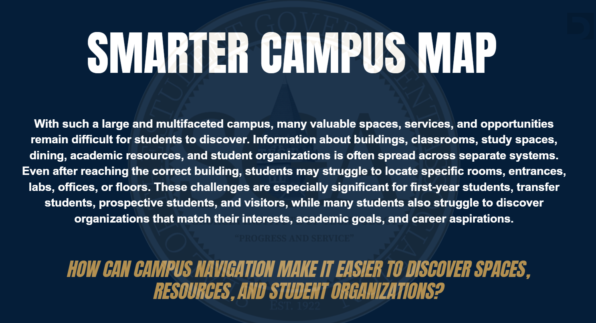
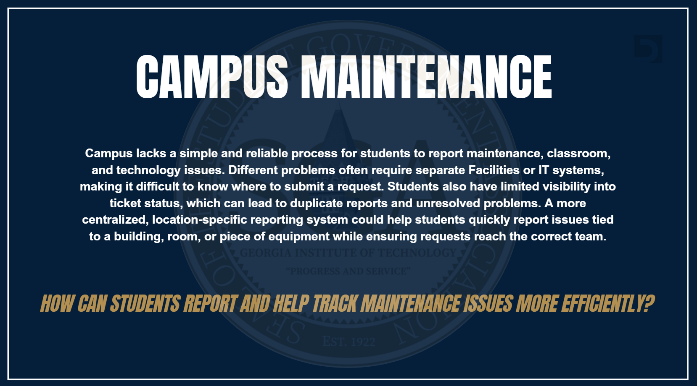
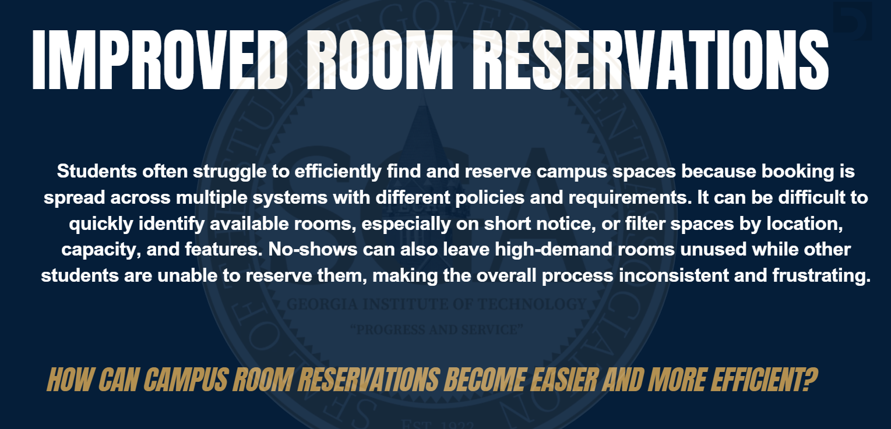

# Problem Statement

## The challenges (as given by SGA)

CIMS answers **one primary** SGA Campus Solutions prompt and **integrates two secondary** prompts,
because both of them come down to *a place on the map*: a room to book, a broken thing to report.

| # | Prompt | Role in CIMS | Where it lands |
|---|--------|--------------|----------------|
| P1 | **Smarter Campus Map** | Primary: the product's core | F-01 to F-07 |
| P2 | **Campus Maintenance** | Integrated: report issues from the map, tied to building/room/equipment | F-10 |
| P3 | **Improved Room Reservations** | Integrated: find available rooms on the map and floor plan | F-11, F-18 |

### P1 — Smarter Campus Map (primary)

> With such a large and multifaceted campus, many valuable spaces, services, and opportunities remain
> difficult for students to discover. Information about buildings, classrooms, study spaces, dining,
> academic resources, and student organizations is often spread across separate systems. Even after
> reaching the correct building, students may struggle to locate specific rooms, entrances, labs,
> offices, or floors. These challenges are especially significant for first-year students, transfer
> students, prospective students, and visitors, while many students also struggle to discover
> organizations that match their interests, academic goals, and career aspirations.
>
> ***How can campus navigation make it easier to discover spaces, resources, and student organizations?***

### P2 — Campus Maintenance (integrated)

> Campus lacks a simple and reliable process for students to report maintenance, classroom, and
> technology issues. Different problems often require separate Facilities or IT systems, making it
> difficult to know where to submit a request. Students also have limited visibility into ticket
> status, which can lead to duplicate reports and unresolved problems. A more centralized,
> location-specific reporting system could help students quickly report issues tied to a building,
> room, or piece of equipment while ensuring requests reach the correct team.
>
> ***How can students report and help track maintenance issues more efficiently?***

### P3 — Improved Room Reservations (integrated)

> Students often struggle to efficiently find and reserve campus spaces because booking is spread
> across multiple systems with different policies and requirements. It can be difficult to quickly
> identify available rooms, especially on short notice, or filter spaces by location, capacity, and
> features. No-shows can also leave high-demand rooms unused while other students are unable to
> reserve them, making the overall process inconsistent and frustrating.
>
> ***How can campus room reservations become easier and more efficient?***

## How Might We

**Umbrella HMW:** make **one interactive campus map** the place where students *discover* spaces,
resources and organizations, *book* the rooms they need, and *report* what's broken, all anchored to
the exact building, floor and room?

| Prompt | Focused HMW |
|--------|-------------|
| P1 | HMW make navigation the way students *discover* spaces, resources and orgs, not only get from A to B? |
| P2 | HMW let students report an issue *where it is* in seconds, route it to the right team, and see its status so they don't file duplicates? |
| P3 | HMW let students see *which rooms are free right now*, filter by what they need, and free up rooms nobody showed up for? |

> 💡 The Miro brainstorm had already reached P2 and P3 on its own ("Maintenance Form / report
> something", "reserve a room / locker"). The map is what connects the three.

## Problem breakdown

We split the problem into four gaps. Every MVP feature has to close at least one.

| # | Gap | What it looks like today | Who feels it most |
|---|-----|--------------------------|-------------------|
| G1 | **Fragmentation.** Info lives in many systems | Dining menus, desk hours, makerspace info and org listings each sit on a different site | Everyone |
| G2 | **The last 100 meters.** Indoor wayfinding | You reach the building but can't find the room, the floor, or the right entrance | First-year, transfer, visitors |
| G3 | **Invisible resources.** You don't know what to search for | Help desks, makerspaces and study spaces only get found by word of mouth | First-year, transfer, international |
| G4 | **Org discovery is disconnected from place** | Orgs and events are listed apart from where they happen | Students looking for community |
| G5 | **Reporting goes nowhere visible** (P2) | Students don't know whether an issue goes to Facilities or IT, can't see ticket status, so issues get reported twice or never | Everyone using classrooms, dorms, labs |
| G6 | **Booking is fragmented and wasteful** (P3) | Several booking systems with different rules; hard to find a free room on short notice or filter by capacity/features; no-shows block rooms | Students needing group/study rooms |

## Problem statement

> **Georgia Tech students, especially new students and visitors,** need a **single, place-based way to
> find, book, and report on** campus buildings, rooms, services and organizations, because today that
> information and those processes are **scattered across separate systems and stop at the building
> door**. As a result they **waste time, miss resources they're entitled to, leave problems unreported
> or duplicated, and can't get a room when they need one.**

## Who is affected (target users)

| Segment | Core need | Notes from brainstorm |
|---------|-----------|------------------------|
| First-year students | Learn the campus fast; find classrooms on day one | "Clickable buildings", "breakdown per level" |
| Transfer students | Same as first-years, with less orientation support | |
| International students | Get to know the campus before arriving | "Street view / possible VR for international students" |
| Prospective students & visitors | Orientation; East vs. West campus | "Greater info of west vs east campus" |
| Current students | Find a free study spot, food, an open desk | "Study spaces / density", "Food", "Support" |
| Org leaders & admin | Reach students where they are | "Bulletin Board where community, clubs, orgs, admin can post" |

## Evidence & assumptions to validate

The challenge statement is our main evidence. We have **not** done user research yet, so these are
hypotheses to test at M1 with 5–8 quick student interviews or hallway tests:

| ID | Hypothesis | How we validate | Status |
|----|------------|-----------------|--------|
| H1 | Students have arrived late or gotten lost looking for a room inside a building | Ask: "last time you couldn't find a room?" | ⬜ |
| H2 | Students don't know where most support desks / makerspaces are | Show a list, ask which they know | ⬜ |
| H3 | Students would self-report study-space fullness if it costs ≤ 1 tap | Ask, then observe in prototype | ⬜ |
| H4 | Students find orgs via friends / fairs, not via a directory | Ask: "how did you find your org?" | ⬜ |
| H5 | Existing map tools don't cover indoor or org discovery | Competitive scan (below) | ⬜ |
| H6 | Students have seen a broken thing and not reported it because they didn't know where | Ask: "last broken thing you saw, did you report it? where?" | ⬜ |
| H7 | Students would check a map before filing a report if it shows existing reports | Prototype test: do they +1 instead of duplicating? | ⬜ |
| H8 | Students have given up on booking because they couldn't find a free room quickly | Ask: "last time you needed a room, how did you find one?" | ⬜ |
| H9 | No-shows are common in high-demand rooms | Ask students + observe a popular study area at peak hours | ⬜ |

## Existing alternatives (to scan at M1)

| Alternative | Covers | Gap vs. our HMW |
|-------------|--------|-----------------|
| Official GT campus map | Buildings, parking | _TBD_ after scan |
| Google / Apple Maps | Outdoor navigation | No indoor detail, no orgs, no GT-specific resources |
| Org directory (e.g., Engage) | Orgs, events | Not place-based |
| Dining / library / OIT sites | Their own domain | Fragmented (G1) |
| Transit apps (Stingerette, buses) | Transit | Separate app |
| Facilities work-request portal | Maintenance tickets | _TBD_ after scan (P2: not location-first? no public status?) |
| IT service desk portal | Tech issues | _TBD_ after scan (P2: separate from Facilities) |
| Room booking systems (library, departmental, student center) | Reservations | _TBD_ after scan (P3: how many systems, what filters, no-show policy) |

> Fill the "Covers / Gap" columns from a 30-minute scan. Don't assume, since a judge may ask.

## What success looks like

A first-year opens one link, finds the building, sees it's open and BuzzCard-accessible, goes to the
right floor, finds the room, and on the way discovers a makerspace and a club meeting nearby. In the
room, the projector is broken: two taps report it against *that room*, they see someone already
reported it and +1 instead. After class they need a group room: the map shows which ones are free
right now on the same floor.
