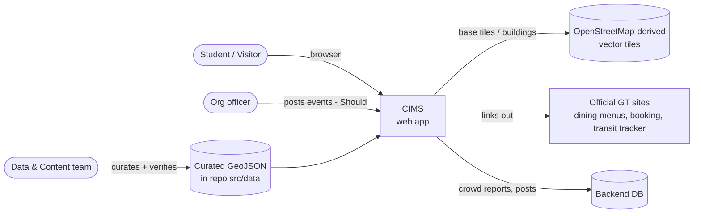
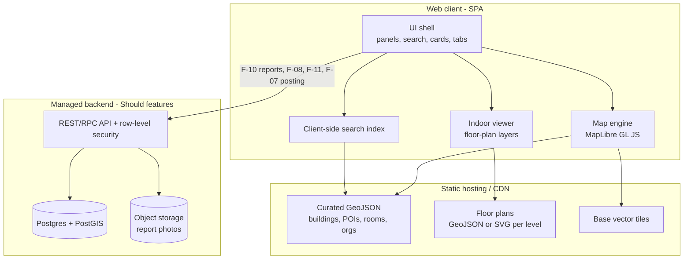
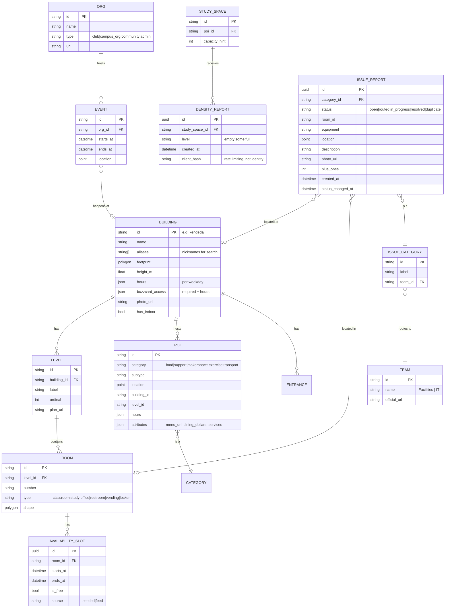

<!-- summary: System design: C4 diagrams, stack, data model (ER), key flows, cross-cutting concerns. -->
# Architecture

> **Status:** Mixed. The frontend stack is **built and live** (Vite + React + TypeScript + MapLibre,
> auto-deployed to https://cims.queenalexandria.online). Data, 3D and backend choices are **Proposed**.
> This page is the *system* design; for *where code goes* see [ARCHITECTURE.md](ARCHITECTURE.md).
> Change a decision by superseding its ADR, not by editing this page alone.

## 1. Architectural drivers

| Driver | Consequence |
|--------|-------------|
| Hackathon timeline | Managed services, one language end-to-end, minimal ops |
| $0 budget | Open map data (OSM), open-source renderer, free tiers |
| Mobile-first, link-shareable | Web SPA (PWA caching to add), not native |
| 3D/isometric campus + indoor floors | Renderer must support building extrusion and custom indoor layers |
| Mostly static, curated data + a little user-generated data | Static GeoJSON for curated content; small DB for crowd reports/posts |
| Data trust | Provenance fields on every record; schema validation before merge |

## 2. System context (C4 level 1)

## 3. Containers (C4 level 2)

**Key idea:** the navigation and discovery features (F-01 to F-07) run on **static data only**. The
backend is needed for user-generated data: **issue reports (F-10)**, crowd density (F-08), org posting,
and room availability (F-11) if it isn't static. If the backend fails during the demo, navigation still
works and F-10 falls back to a local queue that syncs later.

## 4. Proposed tech stack

| Layer | Choice | ADR |
|-------|--------|-----|
| App framework | **Vite + React 18 + TypeScript** SPA ✅ live | [ADR-0002](adr/0002-web-spa-vite-react.md) |
| Map rendering | **MapLibre GL JS** ✅ live (OSM raster tiles); `fill-extrusion` 3D buildings proposed | [ADR-0003](adr/0003-maplibre-2d-with-3d-extrusion.md) |
| Curated data | Versioned GeoJSON in `src/data/` ✅ (`places.json`); provenance + schema check proposed | [ADR-0004](adr/0004-curated-data-as-versioned-geojson.md) |
| Backend (F-10, F-08, F-11) | Supabase **or** `server/` + Postgres on Alexandria (open) | [ADR-0005](adr/0005-backend-supabase.md) |
| Search | Client-side fuzzy index (e.g., Fuse.js / MiniSearch) over curated data | *(small; no ADR)* |
| Hosting | **Alexandria**: nginx behind Traefik, cron auto-deploy from `main` ✅ | [deploy/README.md](../deploy/README.md) |
| CI | None yet. Proposed: GitHub Actions running `npm run build` + data validation on PRs | |

## 5. Data model

All curated entities share a **provenance block**:
`source_url`, `verified_at` (ISO date), `verified_by`.

Curated entities (Building, Level, Room, POI, Org, Event-seed) live in `src/data/` as GeoJSON/JSON
(today: `places.json` with `id`, `name`, `category`, `description`; the model above is where it grows).
Room booking metadata (capacity, features, owning system, policy) is curated in `src/data/` on the ROOM
record. User-generated and time-varying entities (DensityReport, IssueReport, AvailabilitySlot, posted
Events) live in Postgres. Category → team routing is a curated table, so changing it is a data PR.

## 6. Key flows

**Find a room (US-04.1 → US-06.1)**
1. User types "Kendeda 210" (example) → client search matches alias `kendeda` + room `210`.
2. Map flies to building → highlight → card.
3. Indoor viewer loads the `kendeda` level containing that room → highlights room polygon.

**Report study-space fullness (US-08.1)**
1. User taps "Full" → client POSTs `{study_space_id, level}`.
2. DB policy / function enforces 1 report per client hash per space per 15 min.
3. Map layer reads a view: last-2h weighted average → color, or "No recent data".

**Report an issue (US-10.1 → US-10.2)**
1. User taps **Report** inside a room (e.g., `kendeda-210`) → form prefilled with building/floor/room.
2. User picks *Classroom tech* → UI shows "Routes to: IT" (from ISSUE_CATEGORY → TEAM).
3. Client queries open reports for same room + category → shows duplicates with **+1**.
4. Submit → insert ISSUE_REPORT (status `open`) → status page link; staff view sees it under IT.

**Find a free room (US-11.1)**
1. User picks *Available now, ≥ 4, whiteboard* → query AVAILABILITY_SLOT ⨝ ROOM features.
2. Matching rooms highlight on the map; on the floor plan, the room polygon is filled.
3. **Book** → deep link to the owning system from the ROOM record.

## 7. Cross-cutting concerns

| Concern | Approach |
|---------|----------|
| Accessibility | Every map entity also reachable via search and list views; keyboard navigation; ARIA on panels |
| Privacy | No accounts; no server-side location; client hash only for rate limiting, rotated daily |
| Abuse | Rate limits; content length caps; escaped rendering; posting allowlisted in MVP |
| Offline / demo safety | Add a service worker to cache app shell + curated data (not set up yet); demo runs without backend |
| Observability | Privacy-friendly page analytics + error tracking (free tier) |
| Data freshness | Validation warns on records with `verified_at` > 90 days |

## 8. Evolution (post-hackathon)

- Replace curated GeoJSON with an official GT GIS source if access is granted.
- Density prediction model (F-13) trained on accumulated `DENSITY_REPORT` data.
- Indoor routing graph per level (F-14).
- SSO (GT login) before enabling open posting or reservations.
- Real ticket hand-off: push F-10 reports into Facilities/IT systems (email or API) instead of simulating.
- No-show release (F-18): check-in via QR/NFC at the room, auto-release after a grace period.
