# Roadmap & Milestones

> Hackathon dates are **TBD** (open question Q1). Milestones are defined by **exit criteria**, not
> dates. Fill in the target dates at M0. If time gets short, cut scope, not quality: drop *Should*
> before touching *Must*.
>
> Task-level breakdown, owners and order: **[WORKPLAN](WORKPLAN.md)**.

## Timeline overview

```mermaid
gantt
  dateFormat  X
  axisFormat  %s
  title CIMS: phases (relative, fill dates at M0)
  section Hackathon
  M0 Kickoff & scope lock          :m0, 0, 1
  M1 Map foundation & data         :m1, after m0, 3
  M2 MVP feature-complete          :m2, after m1, 4
  M3 Polish & demo freeze          :m3, after m2, 2
  M4 Submission & pitch            :milestone, m4, after m3, 0
  section Post-hackathon
  Phase 2 Community & live data    :p2, after m4, 6
  Phase 3 Campus-wide & integrations :p3, after p2, 8
```

## Milestones

### M0 — Kickoff & scope lock · Target: _TBD_

**Goal:** everyone agrees on what we build and who owns what.

- [ ] Hackathon rules, deliverables and judging criteria read and summarized (Q1)
- [ ] Charter ratified; roles assigned in [RACI](06-team-raci.md)
- [ ] Pilot area + pilot building(s) chosen (Q3); floor plan source confirmed (Q2)
- [ ] ADR-0002 to 0005 accepted or replaced
- [x] Repo + map app backbone + auto-deploy to the live URL (David, done)
- [ ] Board (GitHub Projects); CI on PRs running `npm run build`

**Exit:** ~~a "hello map" on a public URL~~ ✅ already live; MoSCoW list frozen.

### M1 — Map foundation & data · Target: _TBD_

**Goal:** the map exists and the data pipeline is trustworthy.

- [ ] F-01 base map with extruded buildings; building tap → id (ADR-0003 spike)
- [ ] Data schemas + validation (ADR-0004), provenance fields on `places.json`
- [ ] Seed data for the pilot area: buildings, Food, Support, Makerspaces, Exercise, **verified**
- [ ] Floor plans for pilot building(s) digitized (levels + rooms, incl. room capacity/features for F-11)
- [ ] Issue category → Facilities/IT routing table drafted (Q8); room availability source decided (Q7)
- [ ] 5 quick user interviews / hallway tests for H1–H5 ([Problem Statement](01-problem-statement.md))
- [ ] Competitive scan filled in

**Exit:** tapping a pilot building shows real, verified data.

### M2 — MVP feature-complete · Target: _TBD_

**Goal:** all **Must** features meet their acceptance criteria.

- [ ] F-02 layers + legend · F-03 building card · F-04 search
- [ ] F-05 POI layers · F-06 indoor directory · F-07 orgs & events
- [ ] F-10 report an issue (P2): report, duplicates/+1, status, staff view
- [ ] Should features started **only** if all Must are done: F-11 room finder (P3) → F-08 → F-09

**Exit:** the 3 core journeys work end-to-end on a phone; hallway test ≥ 80% task success.

### M3 — Polish & demo freeze · Target: _TBD_

**Goal:** the demo can't fail.

- [ ] Accessibility pass (WCAG AA on UI), performance pass (Lighthouse mobile)
- [ ] Demo script rehearsed 3× clean; backup video recorded
- [ ] Offline fallback (service worker) verified on the demo device
- [ ] Pitch deck: problem → demo → impact → roadmap → team
- [ ] **Code freeze:** only demo-blocking fixes after this point

**Exit:** release checklist in the [Definition of Done](07-definition-of-done.md) is satisfied.

### M4 — Submission & pitch · Target: _TBD_

- [ ] Submission form, repo link, README, video, deck submitted before deadline (with buffer)
- [ ] Live demo + Q&A (use ADRs and the Risk Register for likely questions)
- [ ] Retro within 48 h ([meeting notes template](../templates/meeting-notes.md))

## Post-hackathon (vision for the pitch)

| Phase | Theme | Features |
|-------|-------|----------|
| **Phase 2** | Community & live data | F-08 density at scale, real F-10 hand-off to Facilities/IT, F-18 no-show release, F-07 open posting with GT SSO, F-12 stories/feed, F-17 dining capacity & reviews |
| **Phase 3** | Campus-wide & integrations | Indoor maps for all buildings, F-14 indoor routing, F-20 unified booking across systems, F-19 lockers, F-13 activity heat map + density model, F-15 NFC tags, F-16 VR/street-view tour, East vs. West campus guide |

## Now / Next / Later (living view)

| Now | Next | Later |
|-----|------|-------|
| M0 tasks | F-01 spike, data schemas | Should features |

_Update this table at every stand-up that changes priorities._
