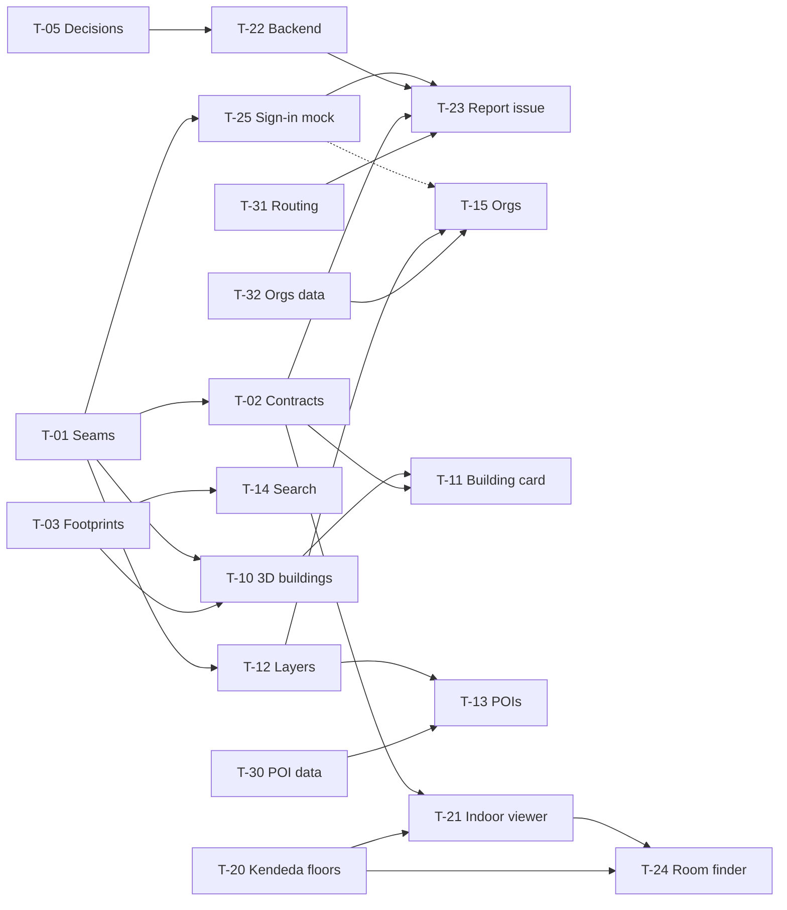

<!-- summary: Lanes, file ownership, anti-conflict rules, agent workflow and the prioritized task checklist (T-xx). -->
# Work Plan: who does what, in what order, without stepping on each other

> **Read this before starting any task, whether you're a human or a Claude.**
> The checklist is ordered by priority: finish P0 before P1, Must before Should.
> Feature IDs (`F-xx`) → [MVP](02-mvp.md) · Stories & acceptance criteria → [PRD](03-prd.md).

## 1. How we split the work: two lanes, separate files

We work in **two lanes**. Each lane **owns its own folders**, so two people (and two Claudes) can work
all day without touching the same file. Conflicts can only happen in a short list of **hotspot
files**, and those follow special rules (§3).

| Lane | Owner | Theme | Features |
|------|-------|-------|----------|
| **A: Outside** | **David** | The campus map: 3D buildings, layers, building card, search, POIs, orgs | F-01 to F-05, F-07, F-09 |
| **B: Inside + Actions** | **Tato** | Floor plans, indoor directory, report an issue, room finder, backend | F-06, F-10, F-11 |
| **Data** | Both (whoever is free) + Claude for research | Verified places, floor plans, routing table, orgs | Feeds both lanes |

> Lane assignment is a proposal. Swap if you prefer; just update this table and §2.

## 2. File ownership map

**Rule:** only touch files in your lane. If you need something in the other lane, ask its owner,
or open a tiny separate PR they review.

| Path | Owner |
|------|-------|
| `src/map/layers/buildings.ts`, `pois.ts`, `orgs.ts`, `transport.ts` | A (David) |
| `src/panels/building-card/`, `src/panels/search/`, `src/panels/layers/`, `src/panels/bulletin/` | A (David) |
| `src/data/buildings.geojson`, `src/data/orgs.json` | A (David) |
| `src/auth/**` (sign-in mock, adapter), `src/panels/account/` | A (David) |
| `src/indoor/` (viewer, level selector, directory) | B (Tato) |
| `src/map/layers/rooms.ts`, `reports.ts` | B (Tato) |
| `src/panels/report/`, `src/panels/rooms/` | B (Tato) |
| `src/data/indoor/<building-id>/` (levels + rooms) | B (Tato) |
| `src/data/issue-routing.json`, `server/` or `supabase/` | B (Tato) |
| `src/data/pois/<category>.json` (one file per category) | Data: whoever claims that category |
| `scripts/` | Whoever wrote the script |
| `docs/` | Anyone; small PRs |

### Hotspot files (shared, see §3)

`src/App.tsx` · `src/components/MapView.tsx` · `src/types/*` · `src/state/*` · `src/styles.css` ·
`src/config.ts` · `package.json` + `package-lock.json` · `.github/` · `.claude/` · `scripts/gen-index.mjs` · `deploy/`

**Generated files** (`INDEX.md` everywhere, `docs/FUNCTIONS.md`) are *not* hotspots: nobody edits
them by hand, conflicts resolve themselves, and they're regenerated on every commit
([MAINTENANCE](MAINTENANCE.md)).

## 3. Rules that keep us from colliding

1. **`main` is production.** It auto-deploys to https://cims.queenalexandria.online. Follow
   **[MERGING-TO-MAIN](MERGING-TO-MAIN.md)**: PR only, green CI, approval from the *other* person, humans merge.
2. **Claim before you start.** Push a branch named after the task ID right away:
   `feat/T10-3d-buildings`. The branch list on GitHub *is* our claim board: if a branch for a task
   exists, it's taken. Open a **draft PR** early.
3. **Hotspot rule:** only **one open PR at a time** may touch a hotspot file. Say it in chat
   ("touching App.tsx") and keep that PR small and merged within the day. Lane work should rarely
   need hotspots after T-01.
4. **Dependencies (`package.json`) only via `chore/` PRs.** Never let two Claudes `npm install` new
   packages in parallel branches; the lockfile conflict is painful. Ask first, add in one small PR.
5. **Contracts before code.** Shared types live in `src/types/` (T-02). Code against the types and
   mock data; don't wait for the other lane's real implementation.
6. **Small PRs, merged often.** Target < 400 changed lines (data files excluded), merged in ≤ 1 day.
   `git pull --rebase origin main` before every push.
7. **One task = one branch = one Claude session.** Don't let a Claude "also fix" something outside
   the task; it lands in the other lane's files.
8. **A human approves every merge.** Claude can review; a person clicks merge.

## 4. Working with our Claudes

### Setup (once)

- The repo root has a [`CLAUDE.md`](../CLAUDE.md) that both Claudes load automatically, plus shared
  hooks in `.claude/settings.json` that keep indexes current and make agents document what they touch
  ([MAINTENANCE](MAINTENANCE.md)). Codex and other agents follow [`AGENTS.md`](../AGENTS.md).
- Use **one git worktree per task**, so a Claude working on T-21 never sees half-done T-23 files:
  ```bash
  git fetch origin
  git worktree add ../cims-T21 -b feat/T21-indoor-viewer origin/main
  cd ../cims-T21 && npm install && claude
  ```
  Remove it after merge: `git worktree remove ../cims-T21`.

### Brief template (paste as the first message of the session)

```
Task: T-21 Indoor viewer (F-06). Lane B.
Read: CLAUDE.md, docs/WORKPLAN.md (§2-3), docs/03-prd.md → US-06.1.
You may edit: src/indoor/**, src/map/layers/rooms.ts, src/data/indoor/kendeda/**.
Do NOT edit: anything else. If you need a hotspot change, stop and tell me.
Contracts: use types from src/types/ as-is; propose changes, don't make them.
Done when: all US-06.1 acceptance criteria pass, `npm run build` passes,
checked at 360 px and desktop. Commit with Conventional Commits, push the
branch, open a draft PR using the template. Do not merge.
```

### Habits that save hours

- **Plan first on anything non-trivial:** ask Claude for a plan, read it, then let it build.
- **Mock first:** Lane B can build the report UI against a fake API before the backend exists.
- **Cross-review:** before asking the other person, run a Claude review on your PR
  (`/code-review` or "review this diff against the acceptance criteria"). The human review then
  focuses on behavior, not typos.
- **Navigate by index.** `INDEX.md` → folder `INDEX.md` → file. Check [`FUNCTIONS.md`](FUNCTIONS.md)
  before writing any helper.
- **Fresh context per task.** Start a new session (or `/clear`) between tasks; long sessions drift.
- **Research with Claude, verify by hand.** Claude can draft POI/hours data from official GT pages,
  but every record needs a `source_url` a human opened (Risk R-01).
- **Don't run two Claudes in the same worktree.**

## 5. Priority checklist

Legend: **Owner** A = David · B = Tato · D = Data (either) · Both.
**Parallel-safe** = can run at the same time as the other lane's current task.

### P0: Foundations (unblock everything; do these first)

- [x] **T-01 Seams refactor** · A · *hotspot PR*
  Turn `MapView.tsx` into a host that loads layer modules from `src/map/layers/` (each exports
  `addTo(map, ctx)`); move `Sidebar` content into `src/panels/`; replace `selectedId` with a
  `Selection` (`{ kind: "building" | "place" | "room" | "report", id }`) in `src/state/`;
  per-component CSS files; `/** @file */` + one-line JSDoc on every file it touches (fills the
  function registry). **Done when:** app looks and behaves exactly as today; build passes.
- [ ] **T-02 Shared contracts** · B · *hotspot PR, right after T-01*
  `src/types/`: `Building`, `Level`, `Room`, `Poi`, `Org`, `Event`, `IssueReport`, `IssueCategory`,
  `AvailabilitySlot`, following the [data model](04-architecture.md#5-data-model), plus provenance
  fields. Tiny mock fixtures in `src/data/mocks/`. **Done when:** both lanes agree in the PR.
- [x] **T-03 Building footprints** · B · *parallel-safe (new files only)*
  `scripts/fetch-buildings.mjs`: Overpass query for the campus bbox → `src/data/buildings.geojson`
  (polygons with `id`, `name`, `aliases`, `height` from OSM `height` or `building:levels` × 3.5 m).
  Hand-check names/IDs for the pilot area. ODbL attribution stays in the UI.
  **Done when:** the file loads in geojson.io and pilot buildings have names + heights.
- [x] **T-04a CI workflow**: `.github/workflows/ci.yml` (index check + build) ✅ in the docs PR
- [x] **T-04b Branch protection** · A (repo admin) · see [MERGING-TO-MAIN § one-time setup](MERGING-TO-MAIN.md#one-time-setup-david-repo-admin) *Decided 2026-11-14: GitHub does not enforce protection on a private repo on a free plan; we work by discipline, see MERGING-TO-MAIN.*
- [x] **T-06 Design tokens + fonts** · A · *hotspot PR (`styles.css`, `package.json`)*
  Apply the tokens, type and header/panel components from [DESIGN-DIRECTION](design/DESIGN-DIRECTION.md);
  fonts via a `chore/` dependency PR. **Done when:** current UI uses the tokens; no gold text on paper.
- [ ] **T-05 M0 decisions (30-min call)** · Both
  - [ ] Hackathon dates, deliverables, judging criteria (Q1)
  - [x] Pilot: **whole campus** in 3D; indoor pilot **Kendeda**, CULC if time (Q3) ✅
  - [x] Entered in **all three prompts** (Q6) ✅: F-10 and F-11 are Must
  - [ ] Backend: Supabase vs. `server/` on Alexandria ([ADR-0005](adr/0005-backend-supabase.md))
  - [ ] Ratify lanes in §1

### P1: MVP Must (both lanes in parallel)

**Lane A: Outside (David)**

- [x] **T-10 3D buildings layer** (F-01) · needs T-01, T-03
  `fill-extrusion` from `buildings.geojson`, tilted default camera, highlight on select, click → `Selection`.
  Look: white roof cap + hatched walls, gold hatch when selected ([DESIGN-DIRECTION § Map styling](design/DESIGN-DIRECTION.md#map-styling-in-maplibre-how-to-actually-build-it-notes-for-t-10--t-12)).
- [x] **T-11 Building card** (F-03) · needs T-02, T-10
  Photo, hours + open-now, BuzzCard access, POIs inside, Directions, **Enter building** (calls Lane B's
  indoor entry point via `Selection`). Enter building button waits for T-21
- [x] **T-12 Layer toggles + legend** (F-02) · needs T-01
- [ ] **T-13 POI layers** (F-05) · needs T-12 and data from T-30 *Survey pins, clusters for stacked places and the filters are done; draft data for food, printing, health, makerspace and exercise is merged (T-30) and waits for human verification.*
- [ ] **T-14 Search** (F-04) · needs T-03; rooms join when T-20 lands *Places done (ranked, accent and typo tolerant, keyboard). Still to add to the index: buildings (the 3D layer has 291 footprints with aliases) and rooms (T-20/T-21).*
  Buildings + aliases + places + rooms; "Kendeda <room>" opens indoor view on the right floor.
- [x] **T-15 Orgs & events layer + bulletin tab** (F-07) · needs T-12, data T-32 *Read-only done (Bulletin tab, event and org cards, weekly demo events, 13 draft real orgs). Officer posting (US-07.2, Should) not started; the sign-in gate (T-25) exists.*
  Read-only bulletin and fictional weekly demo events implemented in Lane A. Posting waits for the sign-in gate T-25.

**Lane B: Inside + Actions (Tato)**

- [ ] **T-20 Kendeda floor-plan data** · D/B · *start immediately, parallel-safe*
  Levels + room polygons/types for Kendeda in `src/data/indoor/kendeda/` (CULC later, same format). Source: public plans if
  permitted, or a walking survey drawn as schematic blocks (Risk R-03). Include room capacity +
  features for F-11.
- [ ] **T-21 Indoor viewer** (F-06) · needs T-01, T-02 (mock rooms until T-20)
  Level selector, rooms layer filtered by level, directory by room type, highlight selected room.
  First indoor building view: Kendeda Level 1 vector schematic and CULC no-plan placeholder, shared Lane A/B. Includes directory, space selection and pan/zoom; 3D remains future work.
  Wayfinding v1 on Kendeda: multilevel schematic routes, stairs or step-free elevator, accessible directions, route leg navigation and responsive plan fitting; CULC has no plan or graph.
- [ ] **T-22 Backend** per T-05 decision · needs T-05
  Tables: `accounts` (opaque id, role, provider, status), `issue_reports`, `issue_plus_ones`, each write with `account_id`; rate limiting per account; env vars documented in `.env.example`.
- [ ] **T-23 Report an issue** (F-10) · UI can start on mocks after T-02; real data needs T-22
  Prefilled location, category → team ("routes to IT"), duplicates + "Me too", status page,
  staff view, "Prototype: not sent to Facilities/IT" label (Risk R-14). Every write (report, +1) goes through the T-25 sign-in gate; the staff view needs the staff role (no unlisted URL).
- [ ] **T-24 Room finder** (F-11, Must since Q6) · needs T-20, T-21
  Availability seed for Kendeda rooms, filters (capacity, features), map + floor highlight, Book deep link.
- [x] **T-25 Sign-in mock + posting gate** (F-21, [ADR-0007](adr/0007-gt-sign-in-simulated.md)) · A · *hotspot PR (`App.tsx`, `src/state/`)* · needs T-01; land it before T-23 and the T-15 posting UI
  **Deliberately theater: looks real, enforces nothing; roles only change labels.** `src/auth/`: `AuthAdapter` interface (`signIn(persona)`, `signOut()`, `session`) with a **mock** adapter (localStorage; demo personas Student / Club officer / Facilities staff / Moderator). `AuthProvider` + `useAuth()` in `src/state/`, `SignInDialog` ("Sign in with Georgia Tech (demo)": never asks for credentials, community-rules checkbox, DEMO badge), a `requireAuth(action)` gate that opens the dialog and resumes the action, an account chip in the header. Types `Session { accountId, role, provider }` in `src/types/`. **Done when:** a signed-out write opens the dialog and continues after sign-in; a reload keeps the session; sign-out clears it; every screen says "Demo sign-in".

> ⚖️ Lane B now carries F-06, F-10 *and* F-11. If it falls behind at M2, move T-24 to Lane A.

**Data lane (whoever is free; good Claude research tasks)**

- [ ] **T-30 Verified POIs**, one PR per category file: *43 drafts merged (food 18, printing 6, health 4, makerspace 6, exercise 9); verification pending, see `docs/data/UNVERIFIED.md`. Support drafts are on Tato's branch `data/T30-T31-support-routing` (old schema, needs adapting).*
  - [ ] `pois/food.json`: dining halls (+ menu link), restaurants (+ Dining Dollars), coffee, vending
  - [ ] `pois/support.json`: desks from the [Miro board](brainstorm/miro-board.md), each verified
  - [ ] `pois/makerspaces.json`
  - [ ] `pois/exercise.json`
- [ ] **T-31 Issue routing table** `issue-routing.json`: category → Facilities / IT + official link (Q8)
- [ ] **T-32 Orgs & events seed** for the demo (real orgs, plausible upcoming events, labeled as demo) *6 fictional demo events (weekly, labeled) and 13 draft real organizations are merged; verification pending.*

### P2: Should (only after every P1 box is checked)

- [ ] **T-40 No-show release** (F-18) · B · QR check-in per room, auto-release after grace period
- [x] **T-41 Offline fallback / PWA** · A · service worker caching the shell + data (Risk R-06)
- [ ] **T-42 Transport layer** (F-09) · A
- [ ] **T-43 Study-space fullness** (F-08) · B · reuses T-22 backend

### P3: Demo & pitch (start T-50 early; the rest at M3)

- [ ] **T-50 Demo scenario seed** · Both: a class in a Kendeda room, broken projector with an existing report,
      two free group rooms, a club meeting nearby (matches [demo script](02-mvp.md#demo-script-3-minutes-draft))
- [ ] **T-51 Hallway tests** with ≥ 5 non-team students; log task success
- [ ] **T-52 Pitch deck**: problem → demo → impact → roadmap → team
- [ ] **T-53 Backup demo video**
- [ ] **T-54 Code freeze + rehearse 3× clean** on the demo device and venue network
- [ ] **T-55 Submit** with ≥ 1 h buffer

## 6. Dependency graph



**Day-one parallel start:** David → T-01 (+ T-04) · Tato → T-03, then T-20 · both → T-05 call.
Nobody touches the same file on day one.

## 7. Sync rituals

- **Daily 10-min sync** ([meeting notes template](../templates/meeting-notes.md)): done / next /
  blocked + "which hotspot am I touching today?"
- **Tick the boxes here** in the same PR that completes the task (one-line change, no conflicts
  in practice because each task has its own line).
- **Blocked > 30 min?** Message the other person right away.
- **Weekly** (if the hackathon spans weeks): [weekly status](../templates/weekly-status.md).
