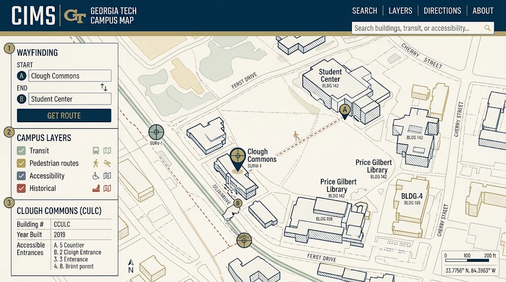

<!-- summary: Chosen visual direction ("survey map"): tokens, type, map styling rules and how to build it in MapLibre. -->
# Design direction: "Survey map"

> **Status:** Chosen by Tato, 2026-11-14. Reference: [`references/map-direction-01.webp`](references/map-direction-01.webp)
> (generated with Gemini). The image is a **mood reference, not a spec**: its labels, building codes
> and data are made up (every building says "BLDG 142"). Take the system from it, not the content.



## The idea in one line

**A university wayfinding sign laid over an architect's survey drawing.** Warm paper, ink linework,
engraved hatching, navy and old gold. It feels drafted, not rendered.

## What makes it ours (keep these, they're the identity)

1. **Isometric buildings with white roofs and hatched walls**, like an engraved plan. Selected or
   featured buildings switch to **gold hatching**.
2. **Survey-marker pins**: a circle with a crosshair (gold ring, ink cross), optionally on a teardrop
   stem. Small tag below in technical caps (`SURV-1` style → for us: room or POI code).
3. **Street names in letter-spaced caps** along the road, ink on paper.
4. **Cartographic furniture**: scale bar + coordinates in a 1px-bordered box (bottom right), a
   minimal north arrow (bottom left).
5. **Numbered section badges** in the side panel (gold disc, ink numeral, 1px ink ring).
6. **Routes as dashed brick-red lines**; transit as sage double lines.
7. **Navy header with a thick gold rule** under it; nav items in condensed caps separated by hairlines.

Doctrine: depth only from **1px lines, hatching and paper grain**. No shadows, gradients, blur or glow.
These 7 treatments are the full set; don't add more effects on top.

## Implementation: the style sheet

**Source of truth:** [`src/styles/tokens.css`](../../src/styles/tokens.css) (colors, type, spacing, lines) and
[`src/styles/cims-ui.css`](../../src/styles/cims-ui.css) (all `cims-*` components). Living demo:
[`styleguide.html`](styleguide.html) (open locally). Not imported by the app yet: wiring them in is **T-06**.
The token block below is the summary; if they differ, the CSS wins.

## Reference gallery (2026-11-14)

| Screen | File | Take | Don't take |
|--------|------|------|------------|
| Map layouts | [`map-variations-01`](references/map-variations-01.webp) | Flat white extrusions + one gold building (simpler than hatching, good fallback); B's collapsible panel sections; C's dashed walking route | Rounded app-window chrome, fake labels |
| Search | [`search-01`](references/search-01.webp) | Grouped results with caps labels; gold underline on match; 1px focus box + gold tick; empty state with outlined "Browse layers" | Fake addresses/room numbers/capacities |
| Layers | [`layers-legend-01`](references/layers-legend-01.webp) | Desktop legend as a ruled table; dotted tree for sub-filters; distinct glyph shapes | Mobile chips' rounded corners, heavy color fills, drop shadow, gibberish labels |
| Floor plan | [`floor-plan-01`](references/floor-plan-01.webp) | Breadcrumb; square level buttons (active navy); solid room fills by type; selected room gold with dashed outline; grouped directory | Duplicated/fake room numbers |
| Glyphs & pins | [`glyphs-pins-01`](references/glyphs-pins-01.webp) | Line icons on a 24px grid; crosshair survey pins in category colors; dark-background check | Inconsistent numbering, mismatched icons inside pins; we draw our own SVGs |

**Category colors are fixed in `tokens.css`** (the mockups disagree with each other): food ochre ▲,
support slate ⊕, makerspace umber ▨, exercise olive ⬡, orgs teal ⌄, transport sage ◆, issues red ⚠,
free rooms green ▯. All ≥ 3:1 on paper; on navy, pins keep a paper ring.

## Tokens

```css
:root {
  /* brand */
  --navy: #003057;        /* header, primary buttons, strong text on light */
  --gold: #B3A369;        /* fills, rules, badges, pins, text ONLY on navy */
  --gold-ink: #8A7A3E;    /* gold for lines/icons on paper (3.7:1, non-text) */
  /* paper & ink */
  --paper: #F3EEE2;       /* map + panel background */
  --paper-2: #E9E2D0;     /* blocks, parks base, hover */
  --ink: #1C2733;         /* text, outlines, hatching (13:1 on paper) */
  --ink-muted: #6B6556;   /* secondary text (5.0:1 on paper) */
  --rule: #1C2733;        /* 1px borders; use at full opacity, never 7% tints */
  /* layer categories (fills/icons; text stays --ink) */
  --cat-transit: #5E7A5A;   /* sage: 4.1:1, icons/fills only */
  --cat-route:   #A33B2B;   /* brick: 5.6:1 */
  --cat-access:  #4A5A6A;   /* slate: 6.1:1 */
  --cat-food:    #B3772E;   /* ochre */
  --cat-free:    #5E7A5A;   /* free rooms reuse sage */
  /* shape */
  --hairline: 1px solid var(--rule);
  --radius: 0;              /* square corners everywhere; circles only for badges/pins */
}
```

**Contrast rules (measured, WCAG):**

| Pair | Ratio | Use |
|------|-------|-----|
| ink on paper | 13.1 | body text |
| navy on paper | 11.6 | headings, links |
| white on navy | 13.5 | header text |
| gold on navy | 5.4 | ✅ button labels, header accents |
| gold on paper | **2.2** | ❌ **never text**. Fills, rules and pins only |
| sage on paper | 4.1 | ❌ not for body text; icons and fills only |

## Typography

| Role | Face | Notes |
|------|------|-------|
| Display / nav / section titles / map labels | **Barlow Condensed** (600–700, caps) | Signage/DIN feel; letter-spacing +0.04em in caps |
| Body / inputs / tables | **IBM Plex Sans** (400/500) | Technical but humane; tabular numbers for hours |
| Codes (room numbers, coordinates, `SURV` tags) | **IBM Plex Mono** (500, small caps size) | Reads as "survey annotation" |

Load with `@fontsource/*` (Vite) or Google Fonts. **Adding packages is a `chore/` PR** ([WORKPLAN §3](../WORKPLAN.md#3-rules-that-keep-us-from-colliding)).
These faces are a proposal matching the reference; swap only for something with the same signage character.

## Components (from the reference)

- **Header:** navy bar, `CIMS` in Barlow Condensed 700, gold vertical hairline, subtitle "Georgia Tech
  Campus Map" in gold caps; 4px gold rule under the bar. Nav: caps, hairline separators.
  ⚠️ **No official GT logo or marks** (Risk R-07). Text only.
- **Search:** white field, hairline border, square, gold-ink magnifier on the right.
- **Side panel:** paper background, hairline border, stacked sections each with a numbered badge and a
  caps title. On mobile it becomes the bottom sheet with the same sections.
- **Inputs:** square, hairline; endpoint badges `A`/`B` as navy discs with white letters.
- **Primary button:** navy fill, gold caps label, square. Secondary: outlined hairline, ink label.
- **Layer rows:** square checkbox filled with the category color + white check, label, line glyph in
  category color on the right. Glyph **shape** must differ per category (works without color).
- **Info table** (building card): two columns, label/value, hairline rules between rows.
- **Map furniture:** scale + lat/lng box bottom right; north arrow bottom left; OSM attribution kept.

## Map styling in MapLibre (how to actually build it): notes for T-10 / T-12

| Look | Technique |
|------|-----------|
| White roofs + hatched walls | Two `fill-extrusion` layers on `buildings.geojson`: (1) walls with `fill-extrusion-pattern` = diagonal hatch image, `height` = building height; (2) a thin "roof cap" with `fill-extrusion-base` = height − 0.4 and `fill-extrusion-color` = paper white. Set `fill-extrusion-vertical-gradient: false` so there are no gradients |
| Gold hatching on selected | Same two layers, filter by `feature-state.selected` → gold hatch pattern image |
| Ink outlines | A `line` layer of footprints at ground level (1px ink). True roof outlines aren't possible in MapLibre; the roof cap + light direction gives the edge |
| Isometric feel | `pitch: 50–60`, `bearing` ≈ −20, and a fixed light: `map.setLight({ anchor: "map", position: [1.5, 210, 30], intensity: 0.3 })` |
| Paper basemap | **Today:** OSM raster with `raster-saturation: -1`, `raster-brightness-min: 0.35`, `raster-contrast: -0.2` (quick, approximate). **Proper:** a vector basemap styled by us (paper land, white roads with ink casing, sage parks, caps street labels with `text-letter-spacing: 0.15`). See ADR-0006 |
| Survey pins | `symbol` layer with SVG icons added via `map.addImage` (gold ring + crosshair), `text-field` code under it in Plex Mono |
| Routes | `line` layer, `line-color: --cat-route`, `line-dasharray: [2, 1.5]` |

Hatch pattern images: tiny SVGs (e.g., 8×8, 1px diagonal ink line on paper) registered with
`map.addImage`. Keep them in `src/map/patterns/`.

## Don'ts from the reference

- Don't copy its fake data ("BLDG 142", "Year Built 2019", garbled entrances).
- Don't label every building at every zoom. Show names from zoom ≥ 16, codes ≥ 17.
- Don't use the GT logo.
- Don't let gold become text on paper anywhere.

## Next references to generate (same style block)

Indoor floor plan, building card on mobile, report-an-issue flow, room finder. Prompts are in the
chat history; save winners in `references/` as `<screen>-NN.webp` and note the pick here.
